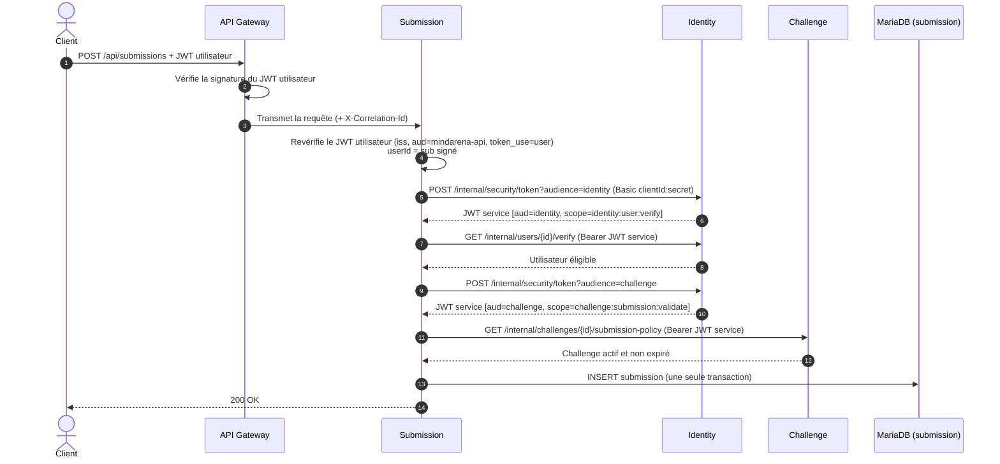

# Fonctionnement de la sécurité interservices — MindArena

Ce document explique **comment** la sécurité entre microservices fonctionne
dans MindArena, en suivant le code réel. Il complète
[service-to-service-security.md](service-to-service-security.md) (décision et
modèle de menace) et le rapport [`docs/report/`](../report/).

---

## 1. Vue d'ensemble

### 1.1 Le problème

Dans une architecture microservices, être « à l'intérieur du réseau » ne prouve
rien. Sans protection, n'importe quel conteneur pourrait appeler directement un
endpoint interne ou envoyer un faux en-tête `X-User-Id: 1` pour se faire passer
pour un autre utilisateur. Le principe **Zero Trust** impose donc que chaque
service **prouve qui il est** (authentification) et **ce qu'il a le droit de
faire** (autorisation) à chaque appel.

### 1.2 Les choix

| Aspect | Choix | Rattachement aux solutions classiques |
| --- | --- | --- |
| Authentification | JWT de service signés **RS256**, durée de vie **120 s** | Jetons JWT ; obtention du jeton sur le modèle du flux **OAuth 2.0 Client Credentials** |
| Autorisation | Identité de service enregistrée + **scope** minimal par opération | Politique statique évaluée sur les **attributs** du jeton (`sub`, `aud`, `scope`, `token_use`) — forme simplifiée d'**ABAC** |
| Défaut | Tout ce qui n'est pas explicitement autorisé est refusé | Moindre privilège, *default deny* |

### 1.3 Les trois services impliqués

| Service | Rôle métier | Rôle de sécurité | Secret détenu |
| --- | --- | --- | --- |
| **Identity** | Comptes utilisateurs | Authentifie les services clients et **émet** les JWT de service ; protège la vérification d'utilisateur | Clé **privée** RSA + empreinte SHA-256 du secret client |
| **Submission** | Enregistre les réponses aux challenges | **Client** : obtient les jetons, appelle Identity et Challenge, n'écrit qu'après deux accords | Secret client brut + clé publique RSA |
| **Challenge** | Catalogue des challenges | **Serveur de ressources** : vérifie le JWT de service et la politique du challenge | Clé publique RSA uniquement |

La **Gateway** ne fait que valider le JWT utilisateur à l'entrée et ne route
**aucun** endpoint `/internal/**`.

---

## 2. La requête protégée de bout en bout

Requête client : `POST /api/submissions` (soumettre une réponse à un challenge).



Si **l'une** des deux vérifications échoue, Submission n'écrit **rien** et
renvoie une erreur cohérente (voir §6).

---

## 3. Authentification : obtenir et vérifier un JWT de service

### 3.1 Submission s'authentifie auprès d'Identity

Fichier : [`ServiceTokenController.java`](../../services/identity-service/src/main/java/com/mindarena/identity/controller/ServiceTokenController.java)

```
POST /internal/security/token?audience=mindarena-challenge-service
Authorization: Basic base64(mindarena-submission-service:<secret>)
```

Identity, via [`ServiceClientRegistry.java`](../../services/identity-service/src/main/java/com/mindarena/identity/security/ServiceClientRegistry.java) :

1. décode l'en-tête Basic (en-tête absent ou malformé → **401**) ;
2. calcule le **SHA-256** du secret reçu et le compare à l'empreinte configurée
   avec `MessageDigest.isEqual` (**comparaison en temps constant**, contre les
   attaques temporelles). Identity ne connaît jamais le secret en clair ;
3. vérifie que l'audience demandée figure dans la table des droits du client
   (audience inconnue → **403**) ;
4. signe le jeton avec sa clé privée.

Table des droits codée dans le registre :

| Client | Audience demandée | Scope accordé |
| --- | --- | --- |
| `mindarena-submission-service` | `mindarena-identity-service` | `identity:user:verify` |
| `mindarena-submission-service` | `mindarena-challenge-service` | `challenge:submission:validate` |

Toute autre combinaison est refusée.

### 3.2 Contenu du jeton

Fichier : [`JwtService.generateServiceToken`](../../services/identity-service/src/main/java/com/mindarena/identity/service/JwtService.java)

```json
{
  "iss": "mindarena-identity-service",
  "sub": "mindarena-submission-service",
  "aud": "mindarena-challenge-service",
  "scope": "challenge:submission:validate",
  "token_use": "service",
  "iat": 1795450000,
  "exp": 1795450120
}
```

| Claim | Rôle |
| --- | --- |
| `iss` | Qui a émis le jeton — seul Identity est accepté |
| `sub` | **Qui appelle** — l'identité du service client |
| `aud` | **Pour qui** est le jeton — un jeton pour Identity est inutilisable chez Challenge |
| `scope` | **Quelle opération** est permise |
| `token_use` | Empêche la confusion entre jeton *utilisateur* et jeton *service* |
| `exp` | Durée de vie courte (120 s par défaut, `SERVICE_JWT_EXPIRATION_SECONDS`) |

**Pourquoi RS256 (asymétrique) plutôt que HS256 ?** Avec HS256, chaque service
vérificateur détiendrait le secret de signature et pourrait donc **forger** des
jetons. Avec RS256, seul Identity possède la clé privée ; les autres n'ont que
la clé publique, qui permet de vérifier mais pas de signer.

### 3.3 Cache des jetons côté Submission

Fichier : [`ServiceTokenProvider.java`](../../services/submission-service/src/main/java/com/mindarena/submission/client/ServiceTokenProvider.java)

- un jeton est mis en cache **par audience** (deux jetons distincts, jamais un
  jeton « universel ») ;
- il est renouvelé **15 s avant** son expiration ;
- l'accès concurrent est protégé (double vérification + `synchronized`) ;
- les jetons ne sont **jamais journalisés**.

### 3.4 Vérification du jeton par le service cible

Fichiers : `SecurityConfig.java` dans
[Identity](../../services/identity-service/src/main/java/com/mindarena/identity/service/SecurityConfig.java)
et [Challenge](../../services/challenge-service/src/main/java/com/mindarena/challenge/security/SecurityConfig.java)

Une chaîne Spring Security dédiée protège `/internal/**` en mode *OAuth2
Resource Server* sans état. Le `JwtDecoder` :

1. vérifie la **signature RS256** avec la clé publique ;
2. vérifie l'**expiration** et l'**émetteur** `mindarena-identity-service` ;
3. exige `token_use = service`.

Un jeton absent, malformé, expiré, forgé, d'un autre émetteur ou de type
utilisateur est rejeté en **401** avant même d'atteindre le contrôleur.

---

## 4. Autorisation : le bon appelant, la bonne cible, la bonne opération

Fichier : `ServiceTokenAuthorizationManager.java` (dans
[Identity](../../services/identity-service/src/main/java/com/mindarena/identity/security/ServiceTokenAuthorizationManager.java)
et [Challenge](../../services/challenge-service/src/main/java/com/mindarena/challenge/security/ServiceTokenAuthorizationManager.java))

Une fois le jeton authentifié, chaque endpoint interne exige **simultanément** :

```java
"service".equals(token_use)
    && caller.equals(sub)            // le bon service appelant
    && aud.contains(audience)        // le jeton est destiné à CE service
    && scopes.contains("SCOPE_" + scope)  // l'opération exacte
```

Politique appliquée :

| Service cible | Endpoint | Appelant exigé | Scope exigé |
| --- | --- | --- | --- |
| Identity | `GET /internal/users/{id}/verify` | `mindarena-submission-service` | `identity:user:verify` |
| Challenge | `GET /internal/challenges/{id}/submission-policy` | `mindarena-submission-service` | `challenge:submission:validate` |
| Identity / Challenge | tout autre `/internal/**` | — | `denyAll()` |

Un jeton valide mais pour **la mauvaise audience**, **le mauvais appelant** ou
**le mauvais scope** est rejeté en **403**.

**Audience vs scope.** L'audience répond à « ce jeton est-il pour moi ? », le
scope à « quelle action autorise-t-il ? ». Les deux sont nécessaires : sans
audience, un jeton volé chez Challenge pourrait être rejoué chez Identity.

---

## 5. Défense en profondeur côté Submission

Fichiers : [`SecurityConfig.java`](../../services/submission-service/src/main/java/com/mindarena/submission/security/SecurityConfig.java),
[`UserTokenValidator.java`](../../services/submission-service/src/main/java/com/mindarena/submission/security/UserTokenValidator.java),
[`SubmissionApiController.java`](../../services/submission-service/src/main/java/com/mindarena/submission/controller/SubmissionApiController.java)

La Gateway valide déjà le JWT utilisateur, mais Submission **ne lui fait pas
confiance aveuglément** :

- Submission revérifie le JWT utilisateur : signature, émetteur,
  `token_use = user`, `aud = mindarena-api` ;
- l'identifiant de l'auteur est extrait du **`sub` signé** du jeton
  (`Long.valueOf(userToken.getSubject())`) ; les en-têtes `X-User-*` ne sont
  **jamais lus** ;
- un jeton de **service** présenté comme jeton utilisateur est refusé (401).

Conséquence : un attaquant qui contourne la Gateway et appelle Submission
directement avec `X-User-Id: 1` obtient **401**.

---

## 6. Atomicité : pas d'écriture partielle

Fichier : [`SubmissionApiService.submit`](../../services/submission-service/src/main/java/com/mindarena/submission/service/SubmissionApiService.java)

```java
@Transactional
public Submission submit(SubmissionRequest request, Long authorId) {
    UserVerificationResponse verifiedUser = identityServiceClient.verifyUser(authorId);          // 1
    ChallengePolicyResponse verifiedChallenge = challengeServiceClient.validateSubmission(...);  // 2
    // ... seulement ensuite : mise à jour des projections + INSERT submission              // 3
}
```

Les deux décisions distantes sont prises **avant** toute écriture, et le tout
s'exécute dans une transaction. Un refus ou une panne lève une exception, donc
aucune ligne n'est créée.

Correspondance des erreurs
([`ApiExceptionHandler.java`](../../services/submission-service/src/main/java/com/mindarena/submission/controller/ApiExceptionHandler.java)) :

| Situation | Code renvoyé au client |
| --- | --- |
| Utilisateur inexistant / non éligible | **422** |
| Challenge inactif ou date limite dépassée | **422** |
| Challenge introuvable | **404** |
| Identity ou Challenge rejette le jeton de Submission (401/403) | **502** — problème de configuration interne, pas la faute du client |
| Identity ou Challenge injoignable | **503** |

---

## 7. Protections réseau et traçabilité

- **Gateway** ([`application.properties`](../../services/api-gateway/src/main/resources/application.properties)) :
  seules les routes `/api/**` existent ; `/internal/**` renvoie **404**.
  Elle supprime aussi les en-têtes `X-User-*` envoyés par le client avant de
  les réécrire depuis le jeton.
- **Docker Compose** : Identity, Challenge et Submission ne publient **aucun
  port** sur la machine hôte. L'override `docker-compose.security-test.yml` les
  expose uniquement sur `127.0.0.1` pour les tests d'attaque.
- **Kubernetes** ([`k8s/base/security.yaml`](../../k8s/base/security.yaml)) :
  `NetworkPolicy` *default-deny* ; en dehors de la Gateway et de Prometheus
  (métriques), seul le pod `submission` peut joindre Identity et Challenge.
- **Corrélation** : un `X-Correlation-Id` (validé par l'expression
  `[A-Za-z0-9._-]{1,64}`, sinon remplacé par un UUID) est propagé par
  Submission vers Identity et Challenge et apparaît dans les logs
  (`[corr:...]`) des trois services, **sans jamais journaliser de jeton**.

---

## 8. Configuration des secrets

| Variable (`.env`) | Reçue par | Contenu |
| --- | --- | --- |
| `JWT_PRIVATE_KEY` | Identity **uniquement** | Clé privée RSA 2048 (PKCS#8, base64) |
| `JWT_PUBLIC_KEY` | Identity, Gateway, Submission, Challenge | Clé publique RSA (X.509, base64) |
| `SUBMISSION_SERVICE_CLIENT_ID` | Identity, Submission | `mindarena-submission-service` |
| `SUBMISSION_SERVICE_CLIENT_SECRET` | Submission **uniquement** | Secret aléatoire à forte entropie |
| `SUBMISSION_SERVICE_CLIENT_SECRET_SHA256` | Identity **uniquement** | Empreinte SHA-256 du secret |
| `SERVICE_JWT_EXPIRATION_SECONDS` | Identity | Durée de vie des jetons de service (120) |

Génération :

```bash
cp .env.example .env
bash scripts/generate-jwt-keys.sh --write-env .env
bash scripts/generate-service-credentials.sh --write-env .env
```

Le fichier `.env` est ignoré par Git et ne doit jamais être commité.

---

## 9. Comment le vérifier

**Tests unitaires** (13 tests : claims, décodeur, registre, autorisation
exacte, absence d'écriture partielle) :

```bash
bash scripts/test-service-security.sh
```

> Sous Windows, si Maven échoue avec `PKIX path building failed`, ajouter
> `export MAVEN_OPTS="-Djavax.net.ssl.trustStoreType=Windows-ROOT"`.

**Test runtime** (vrais conteneurs, vrais JWT, vraie base) :

```bash
docker compose -p mindarena-security-qa \
  -f docker-compose.yml -f docker-compose.security-test.yml up -d --build
COMPOSE_PROJECT_NAME=mindarena-security-qa bash scripts/smoke-service-security.sh
docker compose -p mindarena-security-qa \
  -f docker-compose.yml -f docker-compose.security-test.yml down -v
```

Ce que le script runtime vérifie :

| Cas testé | Attendu |
| --- | --- |
| Pas de jeton / jeton malformé / jeton utilisateur sur `/internal/users` | 401 |
| En-têtes `X-User-Id` + `X-User-Role: ADMIN` sans jeton (Identity et Submission) | 401 |
| Jeton de service utilisé comme jeton utilisateur sur Submission | 401 |
| Jeton d'audience Identity présenté à Challenge | 403 |
| Bon jeton, bonne audience, bon scope | 200 |
| `/internal/...` appelé via la Gateway | 404 |
| Refus d'Identity puis refus de Challenge | 422 et nombre de lignes inchangé |
| Flux complet valide | 200, soumission créée |

---

## 10. Limites connues

- **Périmètre** : seul le flux `POST /api/submissions` utilise les JWT de
  service. Les autres services (ranking, notification, chat) font encore
  confiance à la Gateway.
- **Révocation** : un jeton volé reste valable jusqu'à son expiration (≤ 120 s).
  La courte durée de vie est la seule protection contre le rejeu.
- **Transport** : les appels internes passent en HTTP clair. mTLS (ou un
  service mesh) serait le complément naturel en production pour chiffrer et
  authentifier au niveau transport.
- **Rotation des clés** : une seule paire RSA, sans `kid` ni endpoint JWKS ; une
  rotation impose de redéployer les services.
- **Éligibilité** : Identity considère aujourd'hui tout utilisateur existant
  comme éligible (pas de notion de compte suspendu).
- **Un seul client enregistré** : le registre est codé pour Submission ;
  ajouter un service client demande de modifier le code.

Pistes d'évolution : TLS/mTLS, serveur OAuth 2.0 complet (Keycloak, Spring
Authorization Server), publication JWKS avec rotation, gestionnaire de secrets
(Vault), moteur de politiques (OPA) si le nombre de règles augmente.
